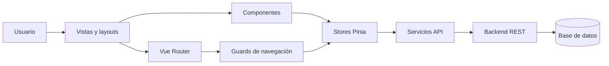

# Sistema de Gestión de Pago de Nómina

Frontend empresarial para administrar el ciclo de pago de nómina, el acceso de usuarios y, progresivamente, la información de colaboradores, contratos, ingresos, deducciones, reportes y auditoría.

> Estado del proyecto: base frontend en desarrollo. El acceso visual está implementado; la autenticación real y los módulos operativos requieren integración con una API de backend.

## Tabla de contenido

- [Objetivo](#objetivo)
- [Estado funcional](#estado-funcional)
- [Tecnologías](#tecnologías)
- [Arquitectura](#arquitectura)
- [Estructura del proyecto](#estructura-del-proyecto)
- [Flujo de autenticación](#flujo-de-autenticación)
- [Instalación y ejecución](#instalación-y-ejecución)
- [Variables de entorno](#variables-de-entorno)
- [Comandos disponibles](#comandos-disponibles)
- [Contrato de API propuesto](#contrato-de-api-propuesto)
- [Próximas integraciones](#próximas-integraciones)
- [Seguridad](#seguridad)
- [Calidad y pruebas](#calidad-y-pruebas)
- [Despliegue](#despliegue)
- [Convenciones de desarrollo](#convenciones-de-desarrollo)

## Objetivo

El sistema busca centralizar y estandarizar la gestión de nómina de una organización mediante una interfaz segura, mantenible y preparada para crecer por módulos.

Alcance esperado:

- Gestionar colaboradores, puestos, departamentos y contratos.
- Configurar períodos y ciclos de nómina.
- Registrar ingresos, bonos, horas extra y comisiones.
- Aplicar deducciones, anticipos, impuestos y prestaciones.
- Calcular y aprobar nóminas.
- Generar boletas de pago y reportes administrativos.
- Mantener trazabilidad de acciones y cambios sensibles.
- Controlar accesos mediante usuarios, roles y permisos.

## Estado funcional

| Área | Estado | Descripción |
| --- | --- | --- |
| Base Vue y TypeScript | Implementado | Proyecto configurado con Vite y componentes Vue. |
| Enrutamiento | Implementado | Ruta pública de acceso y redirección de rutas desconocidas. |
| Diseño del login | Implementado | Interfaz empresarial responsive y accesible. |
| Validación del formulario | Parcial | Validación de campos, carga y mensajes en cliente. |
| Autenticación API | Pendiente | No existe un endpoint de backend configurado. |
| Sesión y autorización | Pendiente | Store, persistencia segura, guards y permisos por rol. |
| Panel principal | Pendiente | `MainLayout.vue` existe como base, pero no tiene funcionalidad. |
| Módulos de nómina | Pendiente | Se detallan en la hoja de ruta. |
| Pruebas automatizadas | Pendiente | Vitest está configurado, pero faltan suites funcionales. |

## Tecnologías

### Aplicación

- Vue 3 con Composition API y componentes SFC.
- TypeScript para tipado estático.
- Pinia para estado global.
- Vue Router para navegación y protección de rutas.
- Tailwind CSS 4 y CSS propio para la interfaz.
- Vite como servidor de desarrollo y empaquetador.

### Calidad

- Vue TSC para verificación de tipos.
- ESLint y Oxlint para análisis estático.
- Prettier para formato.
- Vitest y Vue Test Utils para pruebas unitarias.

## Arquitectura

El frontend sigue una arquitectura modular por dominio. Cada módulo concentra sus vistas, componentes, estado, tipos y comunicación con servicios externos.



### Responsabilidad por capa

| Capa | Responsabilidad | Ejemplo |
| --- | --- | --- |
| `views` | Componer páginas y coordinar casos de uso. | `LoginView.vue` |
| `components` | Elementos reutilizables y presentación. | `LoginForm.vue` |
| `stores` | Estado global, sesión y acciones de negocio del cliente. | `auth.store.ts` |
| `services` | Peticiones HTTP y adaptación de respuestas externas. | `auth.service.ts` |
| `types` | Contratos TypeScript del dominio. | `auth.types.ts` |
| `routes` | Rutas propias de cada módulo. | `auth/routes.ts` |
| `layouts` | Estructura visual compartida entre páginas. | `AuthLayout.vue` |
| `router` | Registro global de rutas y guards. | `router/index.ts` |

### Principios de diseño

- Separar presentación, estado y acceso a datos.
- Organizar el código por dominio, no únicamente por tipo de archivo.
- Mantener componentes pequeños y con una responsabilidad clara.
- Definir contratos TypeScript para entradas y respuestas de la API.
- Evitar llamadas HTTP directas desde componentes visuales.
- Centralizar errores de red, renovación de sesión y encabezados HTTP.

## Estructura del proyecto

```text
payroll-management-frontend/
|-- public/
|   `-- favicon.ico
|-- src/
|   |-- assets/
|   |   `-- css/
|   |       `-- main.css              # Estilos globales y del acceso
|   |-- layouts/
|   |   |-- AuthLayout.vue            # Layout público de autenticación
|   |   `-- MainLayout.vue            # Base del área administrativa
|   |-- modules/
|   |   `-- auth/
|   |       |-- components/
|   |       |   `-- LoginForm.vue     # Formulario, validación y estados
|   |       |-- services/
|   |       |   `-- auth.service.ts   # Cliente de autenticación pendiente
|   |       |-- stores/
|   |       |   `-- auth.store.ts     # Estado de sesión pendiente
|   |       |-- types/
|   |       |   `-- auth.types.ts     # Contratos de autenticación pendientes
|   |       |-- views/
|   |       |   `-- LoginView.vue     # Página de acceso
|   |       `-- routes.ts             # Rutas modulares pendientes
|   |-- router/
|   |   |-- guards.ts                 # Protección de rutas pendiente
|   |   `-- index.ts                  # Router principal
|   |-- stores/
|   |   `-- counter.ts                # Store de ejemplo; debe retirarse
|   |-- App.vue                       # Componente raíz
|   `-- main.ts                       # Bootstrap de Vue, Pinia y Router
|-- env.d.ts
|-- index.html
|-- package.json
|-- tsconfig*.json
|-- vite.config.ts
`-- vitest.config.ts
```

### Estructura objetivo por módulo

Los nuevos dominios deben seguir la misma organización:

```text
src/modules/<dominio>/
|-- components/     # Componentes propios del dominio
|-- composables/    # Lógica reutilizable de Vue
|-- services/       # Comunicación con API
|-- stores/         # Estado Pinia
|-- types/          # DTO, entidades y filtros
|-- views/          # Páginas asociadas a rutas
`-- routes.ts       # Definición de rutas del módulo
```

Elementos compartidos entre dominios deberán ubicarse en futuras carpetas `src/components`, `src/composables`, `src/services`, `src/types` o `src/utils`, según su responsabilidad.

## Flujo de autenticación

### Flujo actual

1. El router dirige `/` hacia `/login`.
2. `AuthLayout.vue` presenta la identidad visual.
3. `LoginView.vue` monta el formulario.
4. `LoginForm.vue` valida correo y contraseña.
5. El formulario informa que la API aún no está configurada.

### Flujo objetivo

1. El usuario envía sus credenciales.
2. El formulario ejecuta la acción `login` del store de autenticación.
3. El store llama a `auth.service.ts`.
4. El servicio envía `POST /auth/login` al backend.
5. El backend valida las credenciales y devuelve la sesión y el usuario.
6. El store conserva únicamente la información necesaria.
7. El router redirige al panel principal.
8. Los guards verifican autenticación y permisos antes de cada navegación.
9. Al vencer la sesión, se intenta renovar mediante un mecanismo seguro.
10. Si la renovación falla, se limpia la sesión y se regresa al login.

## Instalación y ejecución

### Requisitos

- Node.js `22.18+` o `24.12+`.
- pnpm compatible con el archivo `pnpm-lock.yaml`.

### Preparar el proyecto

```bash
pnpm install
```

### Ejecutar en desarrollo

```bash
pnpm dev
```

Vite mostrará la URL local, normalmente `http://localhost:5173`.

### Compilar para producción

```bash
pnpm build
```

El resultado optimizado se genera en `dist/`.

### Revisar el build localmente

```bash
pnpm preview
```

## Variables de entorno

La integración futura debe utilizar variables de Vite y nunca escribir URLs o secretos directamente en los componentes.

Crear un archivo `.env.local` que no se suba al repositorio:

```dotenv
VITE_API_URL=http://localhost:8080/api
VITE_APP_NAME=Nómina Pro
VITE_REQUEST_TIMEOUT=15000
```

Archivo sugerido para documentar valores públicos sin secretos:

```dotenv
# .env.example
VITE_API_URL=http://localhost:8080/api
VITE_APP_NAME=Nómina Pro
VITE_REQUEST_TIMEOUT=15000
```

Las variables `VITE_*` quedan expuestas en el bundle del navegador. Nunca deben contener contraseñas, claves privadas, secretos JWT ni credenciales de infraestructura.

## Comandos disponibles

| Comando | Uso |
| --- | --- |
| `pnpm dev` | Inicia el servidor de desarrollo. |
| `pnpm build` | Ejecuta type-check y genera el build. |
| `pnpm build-only` | Genera el build sin type-check explícito. |
| `pnpm type-check` | Verifica tipos con Vue TSC. |
| `pnpm preview` | Sirve localmente el contenido de `dist`. |
| `pnpm lint` | Ejecuta Oxlint y ESLint con correcciones. |
| `pnpm format` | Formatea el código de `src`. |
| `pnpm test:unit` | Ejecuta Vitest. |

En Windows con una política que bloquee scripts de PowerShell se puede usar:

```powershell
cmd /c pnpm.cmd build
```

## Contrato de API propuesto

El contrato definitivo debe acordarse con el backend. Los siguientes ejemplos sirven como base y no representan endpoints ya implementados.

### Inicio de sesión

```http
POST /api/auth/login
Content-Type: application/json

{
  "email": "usuario@empresa.com",
  "password": "contraseña"
}
```

Respuesta sugerida:

```json
{
  "user": {
    "id": "usr_001",
    "name": "Usuario Administrador",
    "email": "usuario@empresa.com",
    "roles": ["ADMIN"]
  },
  "accessToken": "token-de-corta-duracion",
  "expiresIn": 900
}
```

Para producción se recomienda almacenar el token de renovación en una cookie `HttpOnly`, `Secure` y `SameSite`, administrada por el backend.

### Respuesta de error estándar

```json
{
  "status": 401,
  "code": "INVALID_CREDENTIALS",
  "message": "Correo o contraseña incorrectos",
  "traceId": "req_01ABC"
}
```

### Endpoints previstos

| Dominio | Métodos y rutas sugeridas |
| --- | --- |
| Autenticación | `POST /auth/login`, `POST /auth/refresh`, `POST /auth/logout`, `GET /auth/me` |
| Usuarios | `GET/POST /users`, `GET/PATCH /users/:id` |
| Roles | `GET/POST /roles`, `PATCH /roles/:id` |
| Colaboradores | `GET/POST /employees`, `GET/PATCH /employees/:id` |
| Departamentos | `GET/POST /departments`, `PATCH /departments/:id` |
| Puestos | `GET/POST /positions`, `PATCH /positions/:id` |
| Contratos | `GET/POST /contracts`, `PATCH /contracts/:id` |
| Períodos | `GET/POST /payroll-periods`, `POST /payroll-periods/:id/close` |
| Nóminas | `GET/POST /payrolls`, `POST /payrolls/:id/calculate`, `POST /payrolls/:id/approve` |
| Boletas | `GET /payslips`, `GET /payslips/:id/pdf` |
| Reportes | `GET /reports/*`, exportación CSV, XLSX o PDF |
| Auditoría | `GET /audit-logs` |

## Próximas integraciones

### Fase 1: seguridad y sesión

- [ ] Crear tipos `LoginRequest`, `AuthResponse`, `User` y `Role`.
- [ ] Implementar un cliente HTTP común con URL base y timeout.
- [ ] Conectar `auth.service.ts` con la API.
- [ ] Implementar `auth.store.ts` con login, logout y carga de usuario.
- [ ] Agregar renovación y expiración de sesión.
- [ ] Implementar guards para rutas públicas, privadas y por permisos.
- [ ] Crear recuperación y cambio de contraseña.
- [ ] Sustituir el correo de soporte de ejemplo por el institucional.

### Fase 2: núcleo administrativo

- [ ] Construir el panel principal y navegación lateral.
- [ ] Gestionar usuarios, roles y permisos.
- [ ] Gestionar empresas, sucursales, departamentos y puestos.
- [ ] Gestionar colaboradores, datos bancarios y contratos.
- [ ] Implementar catálogos reutilizables y estados activo/inactivo.

### Fase 3: operación de nómina

- [ ] Configurar periodicidad, calendario y períodos de pago.
- [ ] Definir conceptos de ingresos y deducciones.
- [ ] Registrar salario base, horas extra, bonos y comisiones.
- [ ] Registrar anticipos, préstamos y deducciones recurrentes.
- [ ] Ejecutar cálculo preliminar con validaciones.
- [ ] Crear flujo de revisión, aprobación, cierre y reapertura controlada.
- [ ] Generar boletas individuales y procesamiento por lotes.

### Fase 4: reportes e integraciones

- [ ] Dashboard con indicadores de costo y variación de nómina.
- [ ] Reportes filtrables y exportación a PDF, CSV y XLSX.
- [ ] Envío de boletas por correo y notificaciones internas.
- [ ] Integración bancaria para archivos o transferencias.
- [ ] Integración contable para pólizas y centros de costo.
- [ ] Integración fiscal y de seguridad social según el país.
- [ ] Webhooks para eventos de nómina aprobada y pagada.

### Fase 5: operación y observabilidad

- [ ] Registro de auditoría para acciones sensibles.
- [ ] Manejo centralizado de errores y correlación mediante `traceId`.
- [ ] Monitoreo de errores del frontend.
- [ ] Métricas de uso, rendimiento y disponibilidad.
- [ ] Pruebas end-to-end de los flujos críticos.
- [ ] Pipeline CI/CD con revisión, pruebas y despliegue automatizado.

## Seguridad

El sistema administrará información personal y financiera, por lo que se deben aplicar al menos las siguientes medidas:

- Usar HTTPS en todos los ambientes no locales.
- No guardar contraseñas ni secretos en el frontend.
- Preferir cookies seguras `HttpOnly` para tokens de renovación.
- Mantener los tokens de acceso con una duración corta.
- Implementar autorización real en backend; ocultar botones en frontend no es seguridad.
- Aplicar control de acceso basado en roles y permisos.
- Validar y normalizar datos tanto en cliente como en servidor.
- Evitar mostrar detalles internos en mensajes de error.
- Registrar accesos, aprobaciones, cierres y modificaciones críticas.
- Proteger endpoints contra abuso, fuerza bruta, CSRF y enumeración de usuarios.
- Configurar políticas CSP, CORS y encabezados de seguridad.
- Mantener dependencias actualizadas y revisar vulnerabilidades.
- Definir políticas de respaldo, retención y eliminación de datos.

## Calidad y pruebas

### Estrategia recomendada

| Nivel | Herramienta sugerida | Cobertura esperada |
| --- | --- | --- |
| Tipos | TypeScript y Vue TSC | Contratos, props, stores y servicios. |
| Unitarias | Vitest | Cálculos, validadores, stores y utilidades. |
| Componentes | Vue Test Utils | Formularios, tablas, estados y eventos. |
| Integración | Vitest + mocks HTTP | Stores conectados con servicios. |
| End-to-end | Playwright, integración futura | Login, cálculo, aprobación y cierre. |

Casos mínimos para el módulo de autenticación:

- Campos obligatorios.
- Formato de correo.
- Mostrar y ocultar contraseña.
- Estado de carga y prevención de doble envío.
- Credenciales inválidas y errores del servidor.
- Sesión expirada y renovación.
- Redirección según autenticación y permisos.
- Cierre de sesión y limpieza de estado.

Antes de integrar cambios:

```bash
pnpm type-check
pnpm lint
pnpm test:unit
pnpm build
```

## Despliegue

El frontend genera archivos estáticos en `dist/`, por lo que puede publicarse en Nginx, Apache, un CDN o un servicio de hosting estático.

Requisitos del servidor web:

- Redirigir rutas desconocidas a `index.html` para soportar Vue Router.
- Configurar HTTPS y encabezados de seguridad.
- Habilitar compresión Brotli o gzip.
- Aplicar caché larga a assets con hash y evitar caché prolongada para `index.html`.
- Inyectar la URL correcta de API durante el build de cada ambiente.

Ambientes recomendados:

| Ambiente | Propósito |
| --- | --- |
| Desarrollo | Trabajo local y servicios simulados controlados. |
| QA | Pruebas funcionales e integración con backend. |
| Staging | Validación previa con configuración similar a producción. |
| Producción | Uso empresarial con monitoreo y respaldos. |

## Convenciones de desarrollo

- Componentes Vue en `PascalCase.vue`.
- Composables con prefijo `use`, por ejemplo `usePayrollFilters.ts`.
- Stores con sufijo `.store.ts`.
- Servicios con sufijo `.service.ts`.
- Tipos por dominio con sufijo `.types.ts`.
- Rutas de URL en minúsculas y con guiones.
- Textos visibles en español y código interno con nombres consistentes en inglés.
- No colocar reglas de negocio complejas dentro del template.
- No consumir APIs directamente desde una vista o componente.
- Documentar decisiones técnicas importantes y contratos externos.
- No subir archivos `.env.local`, secretos, tokens ni datos reales de colaboradores.

## Licencia y uso

Proyecto privado. Su uso, distribución y despliegue dependen de las políticas de la organización propietaria.
